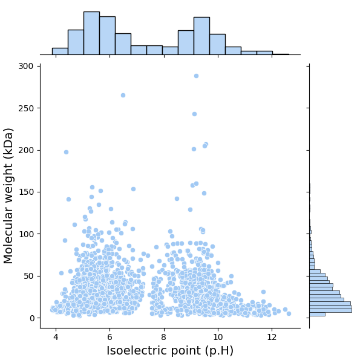
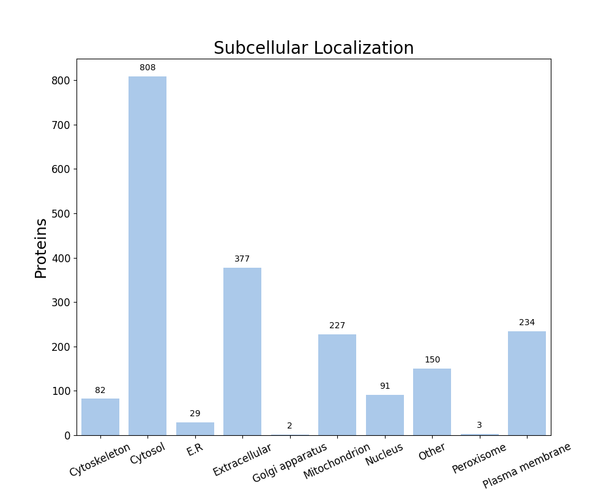

FastProtein Software 1.0
========================
##### Protein Information Software

---
### Summary
| Information                          | Value              |
| ------------------------------------ | ------------------ |
| Processed proteins                   | 2003               |
| Molecular mass (kda) mean            | 32.16 &#177; 25.52 |
| Isoelectric point mean               | 7.30 &#177; 2.05   |
| Hydrophicity mean                    | -0.15 &#177; 0.42  |
| Aromaticity mean                     | 0.09 &#177; 0.04   |
| Proteins with TM                     | 430                |
| Proteins with SP                     | 345                |
| Proteins with GPI                    | 20                 |
| Membrane proteins                    | 436                |
| Proteins with E.R Retention domains  | 247                |
| Proteins with NGlycosylation domains | 1139               |
### Molecular mass (kDa) vs Isoelectric point (pH)

---
### Subcellular localization (by WolfPSort) - Organism: animal

| Subcellular localization | Proteins |
| ------------------------ | -------- |
| Cytosol                  | 808      |
| Extracellular            | 377      |
| Plasma membrane          | 234      |
| Mitochondrion            | 227      |
| Other                    | 150      |
| Nucleus                  | 91       |
| Cytoskeleton             | 82       |
| E.R                      | 29       |
| Peroxisome               | 3        |
| Golgi apparatus          | 2        |
---
### E.R Retention domain summary
| Domain | Quantity |
| ------ | -------- |
| QQEL   | 12       |
| QNEL   | 10       |
| KEEL   | 16       |
| KDEL   | 11       |
| ADEL   | 34       |
| AEEL   | 33       |
| AQEL   | 26       |
| REEL   | 12       |
| QDEL   | 19       |
| SEEL   | 14       |
Only top 10

---
### NGlyc domain summary
| Domain | Quantity |
| ------ | -------- |
| NAS    | 100      |
| NRT    | 78       |
| NLS    | 143      |
| NLT    | 151      |
| NIT    | 90       |
| NIS    | 109      |
| NGT    | 129      |
| NVS    | 102      |
| NGS    | 133      |
| NRS    | 80       |
Only top 10

---
| Id     | Length |  kDa   | Isoelectric_Point | Hydropathy | Aromaticity | Localization  | TMHMM_2 | Phobius_TM | PredGPI | Membrane_evidences | Membrane_evidences_detail |    SignalP5    | Phobius_SP | ER_Retention_Total | NGlyc_Total |          ER_Retention_Domains           |                                                                  NGlyc_Domains                                                                   |                            Header                             | Local_alignment_description | Gene_Ontology | Interpro_Annotation | PFAM_Annotation | Panther_Annotation |
| ------ |:------:|:------:|:-----------------:|:----------:|:-----------:|:-------------:|:-------:|:----------:|:-------:|:------------------:|:-------------------------:|:--------------:|:----------:|:------------------:|:-----------:|:---------------------------------------:|:------------------------------------------------------------------------------------------------------------------------------------------------:|:-------------------------------------------------------------:| --------------------------- | ------------- | ------------------- | --------------- | ------------------ |
| P05431 |  170   | 18.07  |       9.19        |   -0.20    |    0.06     | Extracellular |    1    |     1      |    -    |         2          |    PHOBIUS_TM&#124;TM     |       -        |     -      |         0          |      2      |                                         |                                                             NNT[66-69];NGS[119-122]                                                              |                       Fimbrial protein                        | -                           |               |                     |                 |                    |
| P72097 |  371   | 42.61  |       8.71        |   -0.25    |    0.13     | Extracellular |    1    |     0      |    -    |         1          |            TM             |       -        |     Y      |         0          |      3      |                                         |                                                      NKS[112-115];NGT[183-186];NAS[205-208]                                                      |       N-acetyllactosaminide alpha-2,3-sialyltransferase       | -                           |               |                     |                 |                    |
| P95370 |  483   | 52.11  |       9.48        |   -0.11    |    0.06     |    Cytosol    |    0    |     0      |    -    |         0          |                           |       -        |     -      |         0          |      0      |                                         |                                                                                                                                                  |                       Siroheme synthase                       | -                           |               |                     |                 |                    |
| Q51161 |  285   | 30.31  |       5.31        |    0.06    |    0.05     |    Cytosol    |    0    |     0      |    -    |         0          |                           |       -        |     -      |         0          |      1      |                                         |                                                                    NLT[24-27]                                                                    |                   Dihydropteroate synthase                    | -                           |               |                     |                 |                    |
| Q7DD37 |  488   | 50.55  |       4.81        |   -0.64    |    0.06     | Extracellular |    0    |     0      |    -    |         0          |                           | LIPO(Sec/SPII) |     Y      |         0          |      3      |                                         |                                                      NHT[114-117];NIT[218-221];NGS[444-447]                                                      |              Neisserial heparin binding antigen               | -                           |               |                     |                 |                    |
| Q7DDR9 |  191   | 22.19  |       5.73        |   -0.52    |    0.10     |    Cytosol    |    0    |     0      |    -    |         0          |                           |       -        |     -      |         0          |      3      |                                         |                                                       NIS[63-66];NVS[136-139];NLT[163-166]                                                       |               Protein adenylyltransferase NmFic               | -                           |               |                     |                 |                    |
| Q9JXM7 |  1082  | 113.62 |       6.08        |   -0.35    |    0.07     | Mitochondrion |    0    |     0      |    -    |         0          |                           | LIPO(Sec/SPII) |     Y      |         0          |     11      |                                         | NYT[164-167];NNS[270-273];NLS[321-324];NNT[529-532];NKS[549-552];NET[589-592];NST[639-642];NGT[812-815];NTT[854-857];NGT[924-927];NHS[1070-1073] |          Neisserial autotransporter lipoprotein NalP          | -                           |               |                     |                 |                    |
| Q9JXV4 |  274   | 28.99  |       7.72        |   -0.37    |    0.06     | Extracellular |    1    |     0      |    -    |         1          |            TM             | LIPO(Sec/SPII) |     Y      |         0          |      1      |                                         |                                                                     NRT[1-4]                                                                     |                   Factor H binding protein                    | -                           |               |                     |                 |                    |
| Q9JYL2 |  381   | 41.32  |       5.44        |   -0.24    |    0.06     | Cytoskeleton  |    0    |     0      |    -    |         0          |                           |       -        |     -      |         3          |      2      | AEEL[40-44];RDEL[152-156];AQEL[335-339] |                                                            NLT[185-188];NAT[345-348]                                                             |            Succinyl-diaminopimelate desuccinylase             | -                           |               |                     |                 |                    |
| Q9JZG1 |  517   | 55.40  |       5.68        |   -0.17    |    0.06     |    Cytosol    |    0    |     0      |    -    |         0          |                           |       -        |     -      |         0          |      1      |                                         |                                                                   NAS[239-242]                                                                   |                  2-isopropylmalate synthase                   | -                           |               |                     |                 |                    |
| Q9K0U9 |  915   | 102.11 |       9.45        |   -0.66    |    0.11     | Mitochondrion |    0    |     0      |    -    |         0          |                           |  SP(Sec/SPI)   |     Y      |         0          |      5      |                                         |                                         NGS[265-268];NLS[495-498];NGS[539-542];NNT[565-568];NYT[905-908]                                         |                 Transferrin-binding protein A                 | -                           |               |                     |                 |                    |
| Q9K0V0 |  712   | 77.42  |       5.79        |   -0.92    |    0.09     | Extracellular |    0    |     0      |    -    |         0          |                           | LIPO(Sec/SPII) |     Y      |         1          |      8      |              AEEL[671-675]              |                     NKS[248-251];NFS[421-424];NAS[585-588];NAT[588-591];NTT[648-651];NAT[688-691];NAS[691-694];NSS[695-698]                      |                 Transferrin-binding protein B                 | -                           |               |                     |                 |                    |
| P0A0S8 |  144   | 16.41  |       5.30        |   -0.39    |    0.08     |    Cytosol    |    0    |     0      |    -    |         0          |                           |       -        |     -      |         0          |      0      |                                         |                                                                                                                                                  |               Ferric uptake regulation protein                | -                           |               |                     |                 |                    |
| P0A0V3 |  242   | 26.18  |       6.97        |   -0.31    |    0.05     | Extracellular |    0    |     0      |    -    |         0          |                           |  SP(Sec/SPI)   |     Y      |         0          |      0      |                                         |                                                                                                                                                  |                Outer membrane protein class 4                 | -                           |               |                     |                 |                    |
| P0A0Y6 |  197   | 20.99  |       5.57        |    0.08    |    0.03     |    Cytosol    |    0    |     0      |    -    |         0          |                           |       -        |     -      |         0          |      0      |                                         |                                                                                                                                                  |                   Phosphoheptose isomerase                    | -                           |               |                     |                 |                    |
| P0A0Z6 |  798   | 88.15  |       9.52        |   -0.29    |    0.09     | Extracellular |    1    |     1      |    -    |         2          |    PHOBIUS_TM&#124;TM     |       -        |     -      |         1          |      1      |              RQEL[270-274]              |                                                                   NGS[494-497]                                                                   |                 Penicillin-binding protein 1A                 | -                           |               |                     |                 |                    |
| P30903 |  371   | 39.86  |       5.40        |    0.01    |    0.07     |    Cytosol    |    0    |     0      |    -    |         0          |                           |       -        |     -      |         0          |      1      |                                         |                                                                   NCT[133-136]                                                                   |             Aspartate-semialdehyde dehydrogenase              | -                           |               |                     |                 |                    |
| P55044 |  275   | 30.86  |       9.22        |   -0.28    |    0.08     |    Cytosol    |    0    |     0      |    -    |         0          |                           |       -        |     -      |         0          |      1      |                                         |                                                                   NES[178-181]                                                                   |              Formamidopyrimidine-DNA glycosylase              | -                           |               |                     |                 |                    |
| P65932 |  239   | 25.70  |       6.17        |    0.07    |    0.06     |    Cytosol    |    0    |     0      |    -    |         0          |                           |       -        |     -      |         0          |      0      |                                         |                                                                                                                                                  |                       Uridylate kinase                        | -                           |               |                     |                 |                    |
| Q7DDJ2 |  591   | 62.11  |       5.91        |   -0.43    |    0.05     | Mitochondrion |    0    |     0      |    -    |         0          |                           |  SP(Sec/SPI)   |     -      |         0          |     10      |                                         |         NHT[24-27];NGT[120-123];NFT[123-126];NIT[153-156];NVT[197-200];NVT[202-205];NGS[296-299];NVT[346-349];NIT[366-369];NVS[407-410]          |                 Autotransporter adhesin NhhA                  | -                           |               |                     |                 |                    |
| Q9JS45 |  604   | 66.39  |       5.10        |   -0.33    |    0.08     |    Cytosol    |    0    |     0      |    -    |         0          |                           |       -        |     -      |         0          |      0      |                                         |                                                                                                                                                  |    Sulfite reductase [NADPH] flavoprotein alpha-component     | -                           |               |                     |                 |                    |
| Q9JXF1 |  592   | 64.70  |       8.74        |   -0.17    |    0.07     |    Cytosol    |    0    |     0      |    -    |         0          |                           |       -        |     -      |         0          |      1      |                                         |                                                                   NGT[356-359]                                                                   |                 Bifunctional enzyme BirA/CoaX                 | -                           |               |                     |                 |                    |
| Q9JXI5 |  187   | 20.71  |       5.29        |   -0.33    |    0.07     |    Cytosol    |    0    |     0      |    -    |         0          |                           |       -        |     -      |         0          |      2      |                                         |                                                              NQS[50-53];NLT[63-66]                                                               | D-glycero-beta-D-manno-heptose-1,7-bisphosphate 7-phosphatase | -                           |               |                     |                 |                    |
| Q9JXK7 |  362   | 37.75  |       4.79        |   -0.34    |    0.05     | Extracellular |    0    |     0      |    -    |         0          |                           |  SP(Sec/SPI)   |     Y      |         0          |      3      |                                         |                                                       NLT[91-94];NIT[148-151];NVT[309-312]                                                       |                      Neisseria adhesin A                      | -                           |               |                     |                 |                    |
| Q9JXV5 |  354   | 38.34  |       5.48        |   -0.15    |    0.06     |    Cytosol    |    0    |     0      |    -    |         0          |                           |       -        |     -      |         0          |      2      |                                         |                                                            NAT[122-125];NFS[129-132]                                                             |              Fructose-1,6-bisphosphate aldolase               | -                           |               |                     |                 |                    |
| Q9JXW7 |  299   | 33.03  |       5.55        |   -0.06    |    0.07     |    Cytosol    |    0    |     0      |    -    |         0          |                           |       -        |     -      |         1          |      1      |                SEEL[4-8]                |                                                                    NRT[50-53]                                                                    |            HTH-type transcriptional regulator CrgA            | -                           |               |                     |                 |                    |
##### Only top 10 proteins

---

##### Do you have a question or tips? Please contact us! E-mail: renato.simoes@ifsc.edu.br
Generated time: Sun Sep 27 23:24:18 UTC 2026